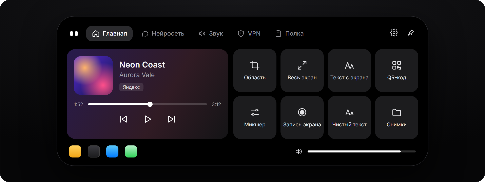
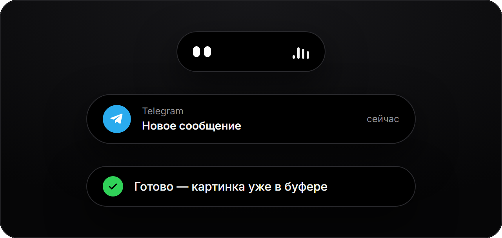
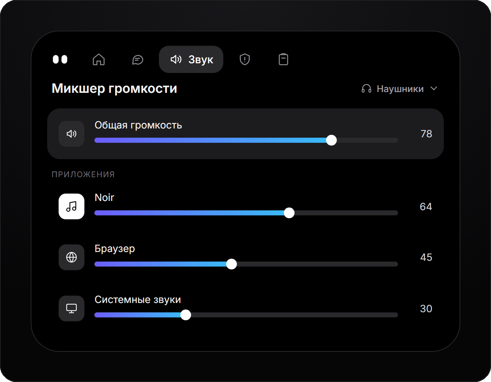

<div align="center">

# Island

**Dynamic Island для Windows 11**

Чёрная капсула вверху экрана: музыка, уведомления и статус системы, а по клику — пульт управления.


[](https://github.com/trualontuu/island-releases/releases/latest)



 

</div>

## Установка

Скачай [Island.zip](https://github.com/trualontuu/island-releases/releases/latest/download/Island.zip), распакуй в любую папку и запусти `Island.exe`. Дальше остров обновляется сам.

Если Windows покажет «Windows защитила ваш компьютер» — «Подробнее» → «Выполнить в любом случае» (программа не подписана платным сертификатом).

## Что умеет

| Вкладка | Что внутри |
|---|---|
| **Капсула** | часы и маскот; при музыке — обложка, эквалайзер и текущая строчка песни; таймер записи; статус Claude Code / opencode; уведомления |
| **Главная** | плеер для любых SMTC-плееров (браузеры, Яндекс Музыка, Spotify, AIMP), 8 быстрых действий, закреплённые приложения, громкость |
| **Нейросеть** | чат через OpenRouter (бесплатные модели), DeepSeek или любой OpenAI-совместимый сервер; стриминг, история |
| **Звук** | микшер громкости по приложениям и выбор устройства вывода |
| **Управление** | Wi‑Fi, Bluetooth, VPN, сон / перезагрузка / выключение |
| **Полка** | история буфера обмена (текст и картинки) и полка для файлов — перетащи на остров, потом утащи куда нужно |
| **Система** | процессор, память, видеокарта, диск, сеть — графики за минуту |
| **Агент** | что делает Claude Code / opencode; разрешения и вопросы подтверждаются прямо с острова |

**Быстрые действия:** скриншот области с разметкой, весь экран, текст с экрана (OCR Windows), QR-код, пипетка, запись экрана со звуком (ffmpeg + NVENC), чистый текст, снимки.

**Ещё:** текст песен (LRCLIB), лайк в Яндекс Музыке, загрузки браузера в капсуле, «интернет пропал / вернулся», индикатор микрофона и выключение его везде, сообщения Telegram.

**Оформление:** 8 тем, прозрачность, FPS и упругость анимаций с живым предпросмотром, автораскрытие, «не мешать вкладкам» — над браузером капсула пропускает клики насквозь.

### Горячие клавиши

| | |
|---|---|
| <kbd>Alt</kbd>+<kbd>Space</kbd> | полка |
| <kbd>Ctrl</kbd>+<kbd>Alt</kbd>+<kbd>Space</kbd> | чат |
| <kbd>Ctrl</kbd>+<kbd>Alt</kbd>+<kbd>S</kbd> | скриншот области |
| <kbd>Ctrl</kbd>+<kbd>Alt</kbd>+<kbd>P</kbd> | нагрузка на ПК |
| <kbd>Ctrl</kbd>+<kbd>Alt</kbd>+<kbd>M</kbd> | микрофон вкл / выкл везде |
| <kbd>Ctrl</kbd>+<kbd>Alt</kbd>+<kbd>L</kbd> | лайк трека в Яндекс Музыке |

## Оптимизация

- Всё на событиях Windows (медиа, буфер, горячие клавиши, полноэкранный режим) — без опроса таймерами.
- Окно всегда размером с остров, рендер на видеокарте — ровно даже на 240 Гц.
- Эквалайзер, маскот и графики работают, только когда их видно; в полноэкранных играх остров прячется целиком.
- Спящий режим: через 20 с без движения мыши остров уезжает за край экрана — **0% процессора**.
- Тяжёлое (настройки, оверлей скриншота) создаётся по запросу, после сворачивания память возвращается системе.

## Сборка

```
dotnet publish -c Release -o dist
```

Проверка без экрана: `Island.exe --snap <папка>` — рисует все вкладки в PNG и прогоняет запрос от «Claude Code» через локальный сервер.
Код используют [Launcher](https://github.com/trualontuu/launcher) и [Noir](https://github.com/trualontuu/player) — держи репозитории в одной папке.
